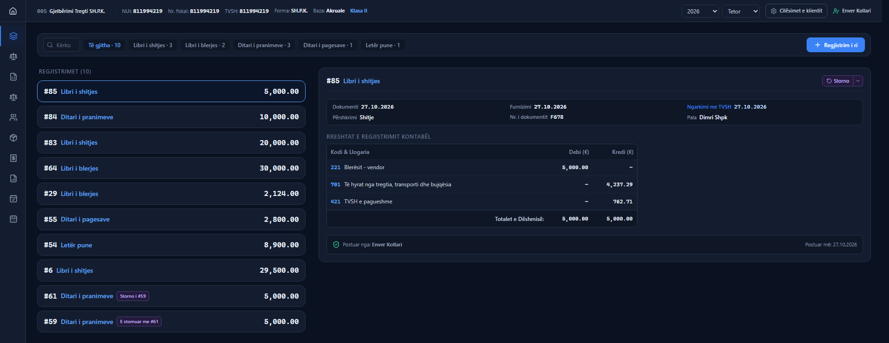
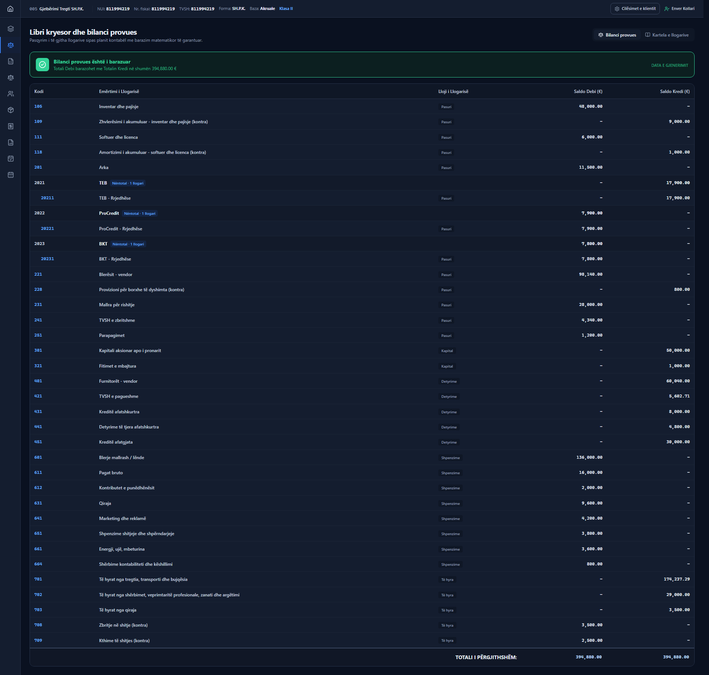
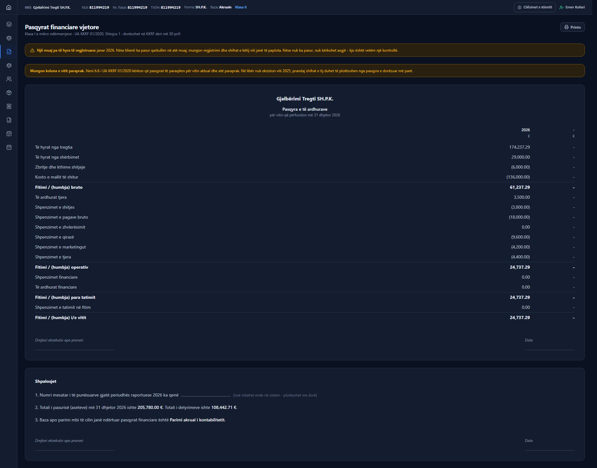
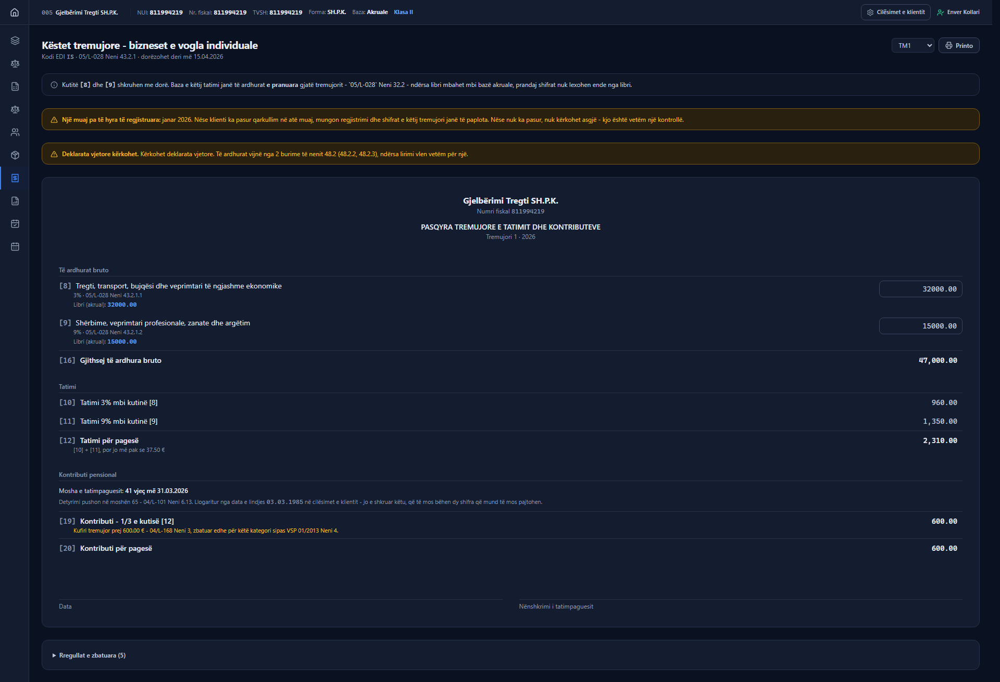
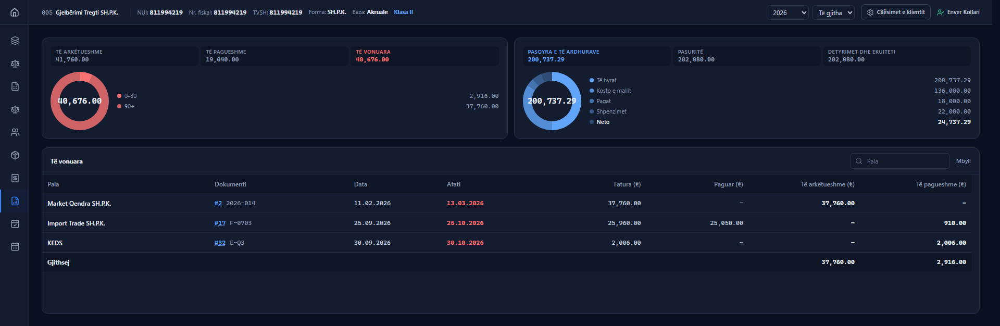

# XCount

Double-entry accounting software for an accounting practice in Kosovo, built to serve many client companies rather than one.

**In development, and my main build right now.** The source is private, so this page is the walkthrough.

---

## What it is for

An accountant in Kosovo keeps the books for a portfolio of companies, and each one is governed by its own set of rules: its legal form, whether it reports on a cash or accrual basis, which size class it falls into, and therefore which statements and declarations it owes and when. Most software asks the accountant to hold all of that in their head.

XCount puts the classification on the client record and lets the rest follow from it.

Five clients, each carrying its legal form, fiscal number, accounting basis and size class, with the filing progress for the year.

---

## The ledger

Entries are posted into named books: sales, purchases, receipts, payments, and a workpaper book for adjustments.

Entry #85 is a sale of 5,000.00 split across three accounts: 221 receivable debited, 701 revenue credited 4,237.29, 421 VAT payable credited 762.71. The entry footer reads **5,000.00 against 5,000.00**, and the posting line records who posted it and when.

Two entries in that list are tagged `Storno i #59` and `E stornuar me #61`. A posted entry cannot be edited, so a mistake is corrected by a reversal that points at the entry it reverses, and the pair stays visible.

That is not a convention the interface is asking nicely for. Posted entries and their lines are **immutable at database level** - `journal_entries_immutable` and `journal_lines_immutable` are triggers, and the audit log is append-only by a third. Application code cannot route around them.

The trial balance states whether it balances rather than leaving it to be eyeballed.

---

## Statements that know which rules apply to them

This is a Class I micro-entity income statement, drawn under UA KKRF 01/2020, Shtojca 1, with its filing deadline of 30 April on the page.

The two amber notices above it are the part worth looking at:

- One month of the year carries no recorded revenue. The notice does not assume an error. It says that if the client traded in that month the figures are incomplete, and if they did not, nothing is required.
- The prior-year column is missing. Article 6.6 of the same instruction requires both years, and the ledger has no 2025, so that column has to come from the statement filed last year.

Software that prints a number is easy. Software that tells the accountant what it cannot yet prove is the harder and more useful thing.

---

## A statutory rules engine, not hardcoded rates

The quarterly instalment return for a small individual business, reproduced box by box as ATK numbers them, from gross income in [8] and [9] through the tax in [12] to the pension contribution in [19] and [20].

Underneath it, the rules the calculation used, each with its citation and the dates it was in force. **No rate is written into the code.** The 3% and 9% bands, the quarterly minimum, the minimum wage, the contribution floor of 127.50 and ceiling of 600.00 are rows in a registry, each version valid for a date range, with a database constraint named `statutory_rules_no_overlapping_versions` preventing two versions of the same rule from covering the same day.

The pension contribution is computed from the taxpayer's date of birth held on the client record, because the obligation ends at 65 under Law 04/L-101 Article 6.13. The age is not typed onto the form, so there are never two figures that can disagree.

The same screen raises this:

> Annual declaration required. Income arrives from two Article 48.2 sources (48.2.2, 48.2.3), while the exemption covers only one.

That conclusion is reached, not printed.

---

## Open items, worked as a receivables book

Invoices by counterparty with ageing buckets, receivable and payable in one view, each line linking back to the journal entry that created it. Overdue dates are marked.

---

## How it is built

- **TypeScript, Next.js, React, PostgreSQL with Prisma.** Interface in Albanian.
- **A dedicated money type**, not floating point. Decimal-backed, half-up rounding, with three scales: four decimal places in the ledger, two in presentation, six for rates.
- **Integrity enforced in the database**, not only in application code: immutability triggers on posted entries, an append-only audit log, and guards on payment allocation that refuse a line settling itself, a line belonging to another client, or a non-positive amount.
- **41 unit test files and 18 database integration test files**, covering the ledger, the money type, the rules engine, the statements and the declarations.

---

## Why this is a walkthrough and not a repository

XCount is a commercial product under development, so the repository is private. I am happy to talk through why it is built the way it is: why a posted entry cannot be edited, why the rates live in a registry rather than in the code, and why the statements raise the warnings they do.

Enver Kollari · [github.com/enverkollari](https://github.com/enverkollari) · enverkollari@hotmail.com
